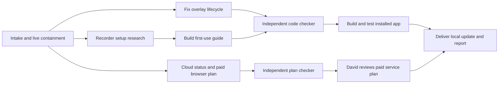

# Rushes first-use and browser product graph

**Final output:** A locally installed Rushes with dismissible camera overlays and a durable, skippable first-recording tour, plus an independently checked plan for a paid browser recorder.
**Level:** 1 — manually coordinated, no recurring or unattended Workflow automation.
**State dir:** `docs/product/first-use-cloud-2026-10-12/`

## Nodes

| Id | Node | Owner / method | Reads | Writes | Parallel group |
|---|---|---|---|---|---|
| N0 | Ground request and safely close stranded bubble | Root | User request; installed status/provenance; shell source; PLAN; graph-design contract | graph, facts, sources, run-log; private containment proof | intake |
| N1 | Recorder first-use research | Root, primary product documentation | Official Loom and Sendspark guides | research-onboarding.md; source entries | discovery |
| N2 | Overlay lifecycle and guide persistence API | Root, implementation | shell main/shared/preload and tests; research brief | Declared shell main/shared/preload files and lifecycle/persistence tests | build |
| N3 | Spotlight first-use guide and visible close/Quit UI | Manually assigned maker | shell renderer/shared contract, PLAN clean-room rules, research-onboarding.md | renderer main/style and new guide component; focused tests | build |
| N4 | Cloud audit and paid browser roadmap | Manually assigned researcher | PLAN Phase 7; cloud/worker/viewer source; primary browser/billing/infrastructure documentation; root live nonsecret status | cloud-plan.md and prefixed source entries | discovery/build |
| C1 | Attack lifecycle, permissions, skip/replay and accessibility | Fresh checker | Final implementation diff and built test results; main atomic/engine helpers and recovery tests; native EngineController/ControlGuide event and preview contracts; no maker working notes | code-verdict.md | check |
| C2 | Attack browser feasibility, tenancy, quotas and unit economics | Fresh checker | cloud-plan.md and cited primary sources | plan-verdict.md | check |
| N5 | Verify and install locally | Root | Passing C1 verdict and local declared gates | Private build/install/GUI proof; run-log | integrate |

## Checkers

- C1 rejects stale asynchronous bubble creation, capture loss on hide/close, permission prompts on mount, nonpersistent dismissal, missed replay, hidden or unreachable guide controls, focus traps and unsafe Quit.
- C2 rejects calling cloud sharing browser recording, assuming the native Swift engine runs in a browser, cross-tenant access, client-only quota enforcement, indefinite raw retention, unpriced video processing and unsupported claims about Loom.
- Checkers write pass/fail and concrete findings. The maker does not set its own output to passed.

## Gates

| Gate | Strictness | Human sees | Unblocks |
|---|---|---|---|
| Local repair and first-use update | Existing authorization | David's 2026-10-12 request for the bubble fix and skippable permission guide | Reversible personal-app implementation and installation |
| Paid browser service | Strict, planning only now | Checked cloud-plan.md, phases, quotas, cost assumptions, chosen launch scope | A later explicit implementation and deployment request |
| Public commercial launch or new service spend | Strict | Exact release, audience, pricing, expected service cost and cap | Public deployment, billing activation or service purchase |

## Stop rules

- Each maker/checker pair has at most two repair retries. Preserve failed evidence.
- Deliver the local app only after changed-surface tests, independent code review and installed behavior checks pass.
- Do not automatically record, grant optional tracking permissions or publish captured media during the tour.
- Skip and completion persist across relaunch; replay is an explicit user action.
- A failed Stop leaves Rushes running with its original footage intact.
- This request creates the paid-service plan, not customer accounts, payment products or a public SaaS deployment.

## Cost estimate

No new paid API, cloud subscription, billing product or commercial deployment is purchased in this run. Ordinary agent usage and local test/build resources apply. The paid-service plan must label vendor costs, workload assumptions and price hypotheses separately.

## Pruned nodes

- Browser-recorder implementation: excluded because David asked for its plan.
- Billing provisioning: excluded until the checked scope and spending are approved.
- New tour library dependency: unnecessary for a small original spotlight component.
- Desktop capture rewrite: unnecessary; the reported issue is overlay lifecycle and discoverability.
